# Hi.

Oh.

You're here.

Give me a second. I was doing something.

<p align="center">
  <a href="https://ayeshamashiat.github.io/ayeshamashiat/desktop.svg">
    
  </a>
</p>

<p align="center"><sub>the folders actually open. just not here, github won't let an image do anything fun. <a href="https://ayeshamashiat.github.io/ayeshamashiat/desktop.svg">here's the real one.</a></sub></p>

### ⌁ Anyway.

I'm **Ayesha**.

I build software, mostly backend stuff, and lately I've been getting curious about **how AI actually works**.

The backend part is going well. The AI part is a rabbit hole. There's a folder for it.

---

# ⟡ Things I've built

<table>
<tr>
<td width="38%" valign="top">

<sub><code>01</code></sub>

### [Bouncer](https://github.com/ayeshamashiat/Bouncer)

A security gate for AI agents. Before one installs a third-party skill, Bouncer checks it against a **threat graph** and answers `ALLOW`, `ASK` or `BLOCK`.

`FastAPI` `FalkorDB` `React` `Cytoscape.js` `MCP` `Claude Code hooks`

</td>
<td valign="top">

Blocklists only catch what's already known. So instead of listing bad skills, it maps how accounts, domains, IPs and payloads connect.

```text
skill → shared infrastructure → known malware
2 hops = BLOCK · 3-4 hops = ASK
```

Weakly connected components cluster reports into campaigns automatically. **92%** detection on hidden malware, versus **0%** for a plain blocklist. Suspicious instructions are read without ever being executed.

</td>
</tr>
<tr>
<td width="38%" valign="top">

<sub><code>02</code></sub>

### [Touch Grass, Babu](https://github.com/ayeshamashiat/Touch-Grass-Babu)

An Android app where an AI mom roasts you for doomscrolling, then locks the app until you go outside.

`Kotlin` `llama.cpp (NDK)` `LoRA` `GGUF` `ML Kit` `WorkManager`

</td>
<td valign="top">

A fine-tuned **Qwen 3.5-4B**, quantized and running **fully offline** on the phone. The app has no internet permission.

```text
3,700-token prompt → distilled into the weights → 4B model → phone
```

Roasts are pre-generated while charging, and on-device vision checks your photo for sky and grass.

</td>
</tr>
<tr>
<td width="38%" valign="top">

<sub><code>03</code></sub>

### [PetniHunter](https://github.com/ayeshamashiat/PetniHunter)

A hallucination guard for a **Bangla** language model. Ask about a writer who doesn't exist and it refuses.

`Python` `Qwen3.5-4B` `Wikidata` `bn.wikipedia`

</td>
<td valign="top">

```text
question → (entity, property) → spelling-tolerant search
         → title similarity → Wikidata type check
         → refuse · redirect · rescue
```

**91.9 F-score** on 2,367 test items with **0.1%** false acceptances. It never silently swaps in a similar name, and it can tell "not found" from "network down".

</td>
</tr>
<tr>
<td width="38%" valign="top">

<sub><code>04</code></sub>

### [AgriSense](https://github.com/ayeshamashiat/CommittedToConflict_AgriSense)

An autonomous farming advisor for smallholder farmers in Bangladesh.

`FastAPI` `ChromaDB` `RAG` `Tool-calling agent` `React` `Web Speech API`

</td>
<td valign="top">

An agent with a tool registry (weather, finance, irrigation, pest risk, marketplace, disease detection) and persistent farmer memory.

**The LLM writes the words. The tools produce every number.** Weather alerts shift the real season plan, it works in Bengali by voice, and every estimate says how uncertain it is.

</td>
</tr>
</table>

<sub>Older work: [CareerPilot](https://github.com/ayeshamashiat/CareerPilor_CodeSprint) (RAG career assistant) · [Jobscape](https://github.com/ayeshamashiat/Jobscape_Backend) (FastAPI, PostgreSQL, spaCy) · [PAMS](https://github.com/ayeshamashiat/PAMS_Backend) (Node, MongoDB, RBAC thesis workflow)</sub>

---

# ∴ The current rabbit hole

## Machine learning

I'm pretty new to it. Right now I'm learning the fundamentals and trying to understand what's actually happening, rather than immediately reaching for a library.

For example:

```python
model.fit(X, y)
```

I'd like to know what that line is actually doing.

```text
$ progress --honest

linear regression    ▰▰▰▰▰▰▱▱▱▱   lines. I understand lines.
gradient descent     ▰▰▰▰▰▱▱▱▱▱   rolling downhill, carefully
classification       ▰▰▰▱▱▱▱▱▱▱   it's a cat. probably.
neural networks      ▰▱▱▱▱▱▱▱▱▱   send help
```

Very much a work in progress.

**Next rabbit holes:** `RAG` · `LangChain` · `LangGraph` · `LLM workflows` · `Agents`

---

# ⌘ My toolbox

```text
┌─ ~/.toolbox ───────────────────────────────────────────────

  LANGUAGES    Python          backend · AI/ML · NLP
               JavaScript      backend · web
               SQL             database work

  BACKEND      FastAPI · Node.js · Express
               REST APIs · auth · JWT · RBAC · business logic

  DATABASES    PostgreSQL · MongoDB · MySQL
               schema design · queries · relationships · migrations

  AI / ML      NumPy · scikit-learn · spaCy · Sentence Transformers
               exploring: RAG · embeddings · LLMs

  INFRA        Docker · AWS · Nginx · GitHub Actions

└────────────────────────────────────────────────────────────
```

---

# ◓ My contributions

<p align="center">
  
</p>

One Pokéball for every day I pushed something. The busier the day, the fancier the ball. Empty grass is a day I didn't. It redraws every night.

---

# ◇ STATUS REPORT

<table>
<tr>
<td align="center" width="33%">

<samp>REPOSITORIES</samp>

# `17+`

</td>
<td align="center" width="33%">

<samp>HACKATHON FINALS</samp>

# `3×`

</td>
<td align="center" width="33%">

<samp>TOP 100</samp>

# `1×`

</td>
</tr>
</table>

```text
$ tail ACHIEVEMENTS.log

[ TOP 100  ]   Solvio AI Hackathon 2025
[ FINALIST ]   CodeSprint — Inter-IUT Hackathon
[ FINALIST ]   SUST CSE Carnival Hackathon
[ FINALIST ]   IUT 12th ICT Fest — Agentic AI Hackathon
```

Three finalist finishes.

One Top 100 placement.

And apparently a growing collection of certificates.

---

# ▧ Currently open

```text
┌─ CURRENTLY OPEN ────────────────────────────────┐
│                                                │
│  [01]  Machine learning fundamentals           │
│  [02]  RAG / LLM rabbit holes                  │
│  [03]  One extremely fast-paced thriller       │
│                                                │
└────────────────────────────────────────────────┘
```

One of these is going significantly better than the others.

I will not tell you which one.

---

# ∿ You're still here

Okay.

So either:

**A)** something here caught your attention.

**B)** you clicked by accident.

**C)** you were intrigued by my profile pic.

**D)** you also have too many tabs open.

Honestly, all four are valid.

If you want to talk about something I'm building, something you're building, or how I ended up reading some extremely niche historical fact at 2 AM—

## say hi.

<p align="center">
<a href="https://www.linkedin.com/in/ayesha-mashiat-89915429a/"></a>
&nbsp;
<a href="https://www.facebook.com/ayesha.mashiat"></a>
&nbsp;
<a href="https://instagram.com/_.ayshiat._"></a>
</p>

---

```text
❯ exit
logout. the tabs stay open.
```

### Thanks for snooping around.

**You may now return to whatever you were supposed to be doing.**
