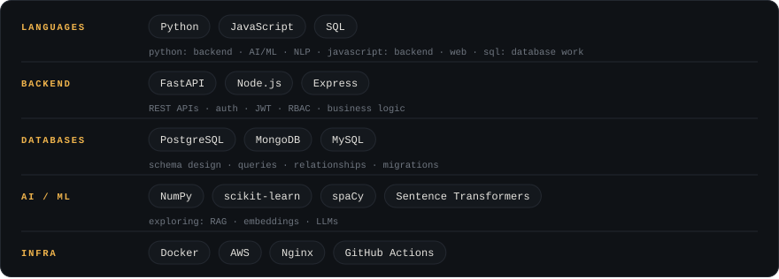

# Hi.

Oh.

You're here.

Give me a second. I was doing something.

<p align="center">
  <a href="https://ayeshamashiat.github.io/ayeshamashiat/desktop.svg">
    
  </a>
</p>

<p align="center"><sub>the folders actually open. just not here, github won't let an image do anything fun. <a href="https://ayeshamashiat.github.io/ayeshamashiat/desktop.svg">here's the real one.</a></sub></p>

### ⌁ Anyway.

I'm **Ayesha**.

I build software, mostly backend stuff, and lately I've been getting curious about **how AI actually works**.

The backend part is going well. The AI part is a rabbit hole. There's a folder for it.


My first real job. Turns out production code is a lot less forgiving than hackathon code.


<sub><code>01</code></sub>

### [Bouncer](https://github.com/ayeshamashiat/Bouncer)

A security gate for AI agents. Before one installs a third-party skill, Bouncer checks it against a **threat graph** and answers `ALLOW`, `ASK` or `BLOCK`.

`FastAPI` `FalkorDB` `React` `Cytoscape.js` `MCP` `Claude Code hooks`

Blocklists only catch what's already known. So instead of listing bad skills, it maps how accounts, domains, IPs and payloads connect.

```text
skill → shared infrastructure → known malware
2 hops = BLOCK · 3-4 hops = ASK
```

Weakly connected components cluster reports into campaigns automatically. **92%** detection on hidden malware, versus **0%** for a plain blocklist. Suspicious instructions are read without ever being executed.

<sub><code>02</code></sub>

### [Touch Grass, Babu](https://github.com/ayeshamashiat/Touch-Grass-Babu)

An Android app where an AI mom roasts you for doomscrolling, then locks the app until you go outside.

`Kotlin` `llama.cpp (NDK)` `LoRA` `GGUF` `ML Kit` `WorkManager`

A fine-tuned **Qwen 3.5-4B**, quantized and running **fully offline** on the phone. The app has no internet permission.

```text
3,700-token prompt → distilled into the weights → 4B model → phone
```

Roasts are pre-generated while charging, and on-device vision checks your photo for sky and grass.

<sub><code>03</code></sub>

### [PetniHunter](https://github.com/ayeshamashiat/PetniHunter)

A hallucination guard for a **Bangla** language model. Ask about a writer who doesn't exist and it refuses.

`Python` `Qwen3.5-4B` `Wikidata` `bn.wikipedia`

```text
question → (entity, property) → spelling-tolerant search
         → title similarity → Wikidata type check
         → refuse · redirect · rescue
```

**91.9 F-score** on 2,367 test items with **0.1%** false acceptances. It never silently swaps in a similar name, and it can tell "not found" from "network down".

<sub><code>04</code></sub>

### [AgriSense](https://github.com/ayeshamashiat/CommittedToConflict_AgriSense)

An autonomous farming advisor for smallholder farmers in Bangladesh.

`FastAPI` `ChromaDB` `RAG` `Tool-calling agent` `React` `Web Speech API`

An agent with a tool registry (weather, finance, irrigation, pest risk, marketplace, disease detection) and persistent farmer memory.

**The LLM writes the words. The tools produce every number.** Weather alerts shift the real season plan, it works in Bengali by voice, and every estimate says how uncertain it is.

<sub>Older work: [CareerPilot](https://github.com/ayeshamashiat/CareerPilor_CodeSprint) (RAG career assistant) · [Jobscape](https://github.com/ayeshamashiat/Jobscape_Backend) (FastAPI, PostgreSQL, spaCy) · [PAMS](https://github.com/ayeshamashiat/PAMS_Backend) (Node, MongoDB, RBAC thesis workflow)</sub>


## Machine learning

I'm pretty new to it. Right now I'm learning the fundamentals and trying to understand what's actually happening, rather than immediately reaching for a library.

For example:

```python
model.fit(X, y)
```

I'd like to know what that line is actually doing.

```text
linear regression    ▰▰▰▰▰▰▱▱▱▱
gradient descent     ▰▰▰▰▰▱▱▱▱▱
classification       ▰▰▰▱▱▱▱▱▱▱
neural networks      ▰▱▱▱▱▱▱▱▱▱
```

Very much a work in progress.

**Next rabbit holes:** `RAG` · `LangChain` · `LangGraph` · `LLM workflows` · `Agents`





<!-- ACTIVITY:START -->
<!-- generated by scripts/activity.py every night; edits in here get overwritten -->

<p align="center">
  
</p>

> **Mom:** You pushed something yesterday. Okay. I will allow one extra cup of cha.

<details>
<summary><b>Ship log</b></summary>

- `2026-11-11` **AyeshaMashiatPortfolio** — Add school and college to Journey, update intro wording ([7dce26e](https://github.com/ayeshamashiat/AyeshaMashiatPortfolio/commit/7dce26ebe1c2ab2fa373ee538f15abb5538a2328))
- `2026-11-11` **AyeshaMashiatPortfolio** — Newspaper theme: new intro, profile and weather boxes, floating CV button, Link… ([1237ad7](https://github.com/ayeshamashiat/AyeshaMashiatPortfolio/commit/1237ad75b34aeb3d81f0317be9ffefff48bd0048))
- `2026-11-10` **Lead-Management-System** — added entities and repositories ([407c2a2](https://github.com/ayeshamashiat/Lead-Management-System/commit/407c2a2f32195b54afb432a28e80958697089f08))
- `2026-11-09` **Lead-Management-System** — folder structure ([a9e45a6](https://github.com/ayeshamashiat/Lead-Management-System/commit/a9e45a6fd95f121d73c04c8b914557bafb3f910e))
- `2026-11-07` **Thunderdome** — budget student pitch; fix test imports for gladiator built extras ([e59bf60](https://github.com/ayeshamashiat/Thunderdome/commit/e59bf60f116b989fe5999f9cd5b779e04ad4a7ac))

</details>
<!-- ACTIVITY:END -->


Three finalist finishes.

One Top 100 placement.

And apparently a growing collection of certificates.


One of these is going significantly better than the others.

I will not tell you which one.


Okay.

So either:

<p align="center">
  
</p>

Honestly, all four are valid.

If you want to talk about something I'm building, something you're building, or how I ended up reading some extremely niche historical fact at 2 AM—

<h2 align="center">say hi.</h2>

<p align="center">
  <a href="https://www.linkedin.com/in/ayesha-mashiat-89915429a/"></a>
  &nbsp;
  <a href="https://dev.to/ayeshamashiat"></a>
  &nbsp;
  <a href="https://www.facebook.com/ayesha.mashiat"></a>
  &nbsp;
  <a href="https://instagram.com/_.ayshiat._"></a>
</p>

<p align="center">
  <a href="mailto:ayesha.mashiat019@gmail.com"></a>
  &nbsp;
  <a href="https://ayeshamashiatportfolio.onrender.com/"></a>
</p>

<p align="center"><sub><a href="mailto:ayesha.mashiat019@gmail.com">ayesha.mashiat019@gmail.com</a> · <a href="https://ayeshamashiatportfolio.onrender.com/">ayeshamashiatportfolio.onrender.com</a></sub></p>

<br>

<p align="center">
  <b>Thanks for snooping around.</b><br>
  <sub>You may now return to whatever you were supposed to be doing.</sub>
</p>
