# Hi.

Oh.

You're here.

Give me a second. I was doing something.

<p align="center">
  <a href="https://ayeshamashiat.github.io/ayeshamashiat/desktop.svg">
    
  </a>
</p>

<p align="center"><sub>the folders actually open. just not here, github won't let an image do anything fun. <a href="https://ayeshamashiat.github.io/ayeshamashiat/desktop.svg">here's the real one.</a></sub></p>

### ⌁ Anyway.

I'm **Ayesha**.

I build software, mostly backend stuff, and lately I've been getting curious about **how AI actually works**.

The backend part is going well. The AI part is a rabbit hole. There's a folder for it.

---

# ⟡ Things I've built

<table>
<tr>
<td width="38%" valign="top">

<sub><code>01</code></sub>

### [CareerPilot](https://github.com/ayeshamashiat/CareerPilor_CodeSprint)

An AI-powered career assistant built around **RAG**.

`FastAPI` `ChromaDB` `Sentence Transformers` `Redis` `Docker`

</td>
<td valign="top">

The idea: give the AI useful information *before* asking it to answer.

```text
documents → embeddings → search → AI → answer
```

And then, inevitably:

> **Why did it retrieve *that*?**

That's what got me interested in retrieval, embeddings and semantic search.

</td>
</tr>
<tr>
<td width="38%" valign="top">

<sub><code>02</code></sub>

### [Jobscape](https://github.com/ayeshamashiat/Jobscape_Backend)

A job discovery backend. Mostly APIs, databases and NLP.

`FastAPI` `PostgreSQL` `SQLAlchemy` `Alembic` `spaCy`

</td>
<td valign="top">

**Focus:** REST APIs · NLP · database design

The sort of project that starts with:

> "This should be pretty straightforward."

It wasn't.

</td>
</tr>
<tr>
<td width="38%" valign="top">

<sub><code>03</code></sub>

### [PAMS Backend](https://github.com/ayeshamashiat/PAMS_Backend)

A **Postgraduate Academic Management System** backend for students, supervisors and thesis workflows.

`Node.js` `Express` `MongoDB` `Mongoose` `JWT` `bcrypt` `Nodemailer`

</td>
<td valign="top">

The whole life of a thesis, as an API:

```text
eligibility → supervisor request → proposal → progress → defense
```

With role-based access for `Admin` · `Student` · `Faculty` · `PGC`, so everyone can only do exactly what they're supposed to. In software, at least.

</td>
</tr>
</table>

---

# ∴ The current rabbit hole

## Machine learning

I'm pretty new to it. Right now I'm learning the fundamentals and trying to understand what's actually happening, rather than immediately reaching for a library.

For example:

```python
model.fit(X, y)
```

I'd like to know what that line is actually doing.

```text
$ progress --honest

linear regression    ▰▰▰▰▰▰▱▱▱▱   lines. I understand lines.
gradient descent     ▰▰▰▰▰▱▱▱▱▱   rolling downhill, carefully
classification       ▰▰▰▱▱▱▱▱▱▱   it's a cat. probably.
neural networks      ▰▱▱▱▱▱▱▱▱▱   send help
```

Very much a work in progress.

**Next rabbit holes:** `RAG` · `LangChain` · `LangGraph` · `LLM workflows` · `Agents`

---

# ⌘ My toolbox

```text
┌─ ~/.toolbox ───────────────────────────────────────────────

  LANGUAGES    Python          backend · AI/ML · NLP
               JavaScript      backend · web
               SQL             database work

  BACKEND      FastAPI · Node.js · Express
               REST APIs · auth · JWT · RBAC · business logic

  DATABASES    PostgreSQL · MongoDB · MySQL
               schema design · queries · relationships · migrations

  AI / ML      NumPy · scikit-learn · spaCy · Sentence Transformers
               exploring: RAG · embeddings · LLMs

  INFRA        Docker · AWS · Nginx · GitHub Actions

└────────────────────────────────────────────────────────────
```

---

# ✦ The night sky

<p align="center">
  
</p>

Every star is a day I contributed something. Three days in a row and they join up into a constellation. The longest ones get names, which they have earned.

It redraws itself every night, so it's either getting brighter or getting suspiciously quiet.

---

# ◇ STATUS REPORT

<table>
<tr>
<td align="center" width="33%">

<samp>REPOSITORIES</samp>

# `17+`

</td>
<td align="center" width="33%">

<samp>HACKATHON FINALS</samp>

# `3×`

</td>
<td align="center" width="33%">

<samp>TOP 100</samp>

# `1×`

</td>
</tr>
</table>

```text
$ tail ACHIEVEMENTS.log

[ TOP 100  ]   Solvio AI Hackathon 2025
[ FINALIST ]   CodeSprint — Inter-IUT Hackathon
[ FINALIST ]   SUST CSE Carnival Hackathon
[ FINALIST ]   IUT 12th ICT Fest — Agentic AI Hackathon
```

Three finalist finishes.

One Top 100 placement.

And apparently a growing collection of certificates.

---

# ▧ Currently open

```text
┌─ CURRENTLY OPEN ────────────────────────────────┐
│                                                │
│  [01]  Machine learning fundamentals           │
│  [02]  RAG / LLM rabbit holes                  │
│  [03]  One extremely fast-paced thriller       │
│                                                │
└────────────────────────────────────────────────┘
```

One of these is going significantly better than the others.

I will not tell you which one.

---

# ∿ You're still here

Okay.

So either:

**A)** something here caught your attention.

**B)** you clicked by accident.

**C)** you were intrigued by my profile pic.

**D)** you also have too many tabs open.

Honestly, all four are valid.

If you want to talk about something I'm building, something you're building, or how I ended up reading some extremely niche historical fact at 2 AM—

## say hi.

<p align="center">
<a href="https://www.linkedin.com/in/ayesha-mashiat-89915429a/"></a>
&nbsp;
<a href="https://www.facebook.com/ayesha.mashiat"></a>
&nbsp;
<a href="https://instagram.com/_.ayshiat._"></a>
</p>

---

```text
❯ exit
logout. the tabs stay open.
```

### Thanks for snooping around.

**You may now return to whatever you were supposed to be doing.**
